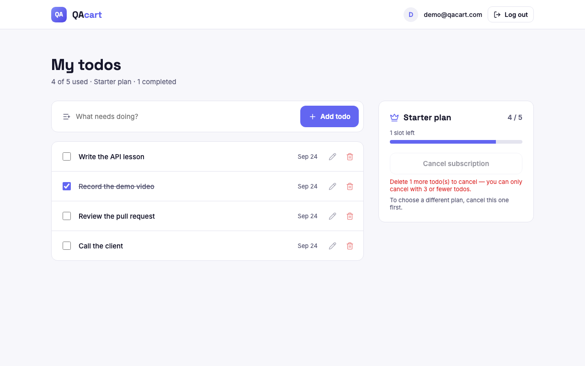
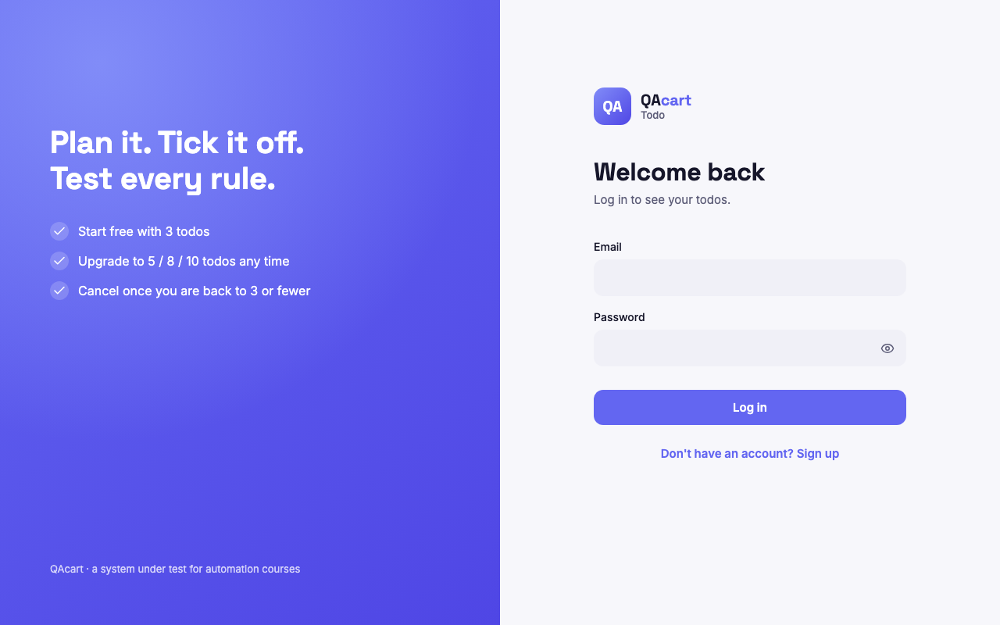
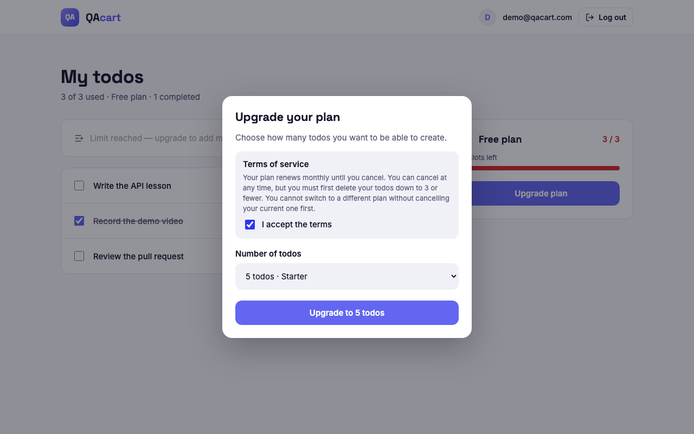

# QAcart Todo v2

A small todo app with a free plan and paid plans, built as a **system under test**
for [QAcart](https://qacart.com) automation courses. It is a SvelteKit web app
backed by SQLite. Every action goes through a **REST API**, so each business rule
can be tested at the API level, at the UI level, or both.

It is the web version of the QAcart Todo mobile app (Flutter). The rules, the
on-screen text and the element ids (`data-testid`) are the same, so you can compare
a device-only app with a real client/server one.



| Log in | Upgrade |
|---|---|
|  |  |

**Stack:** SvelteKit 2 · Svelte 5 · TypeScript · `better-sqlite3` · one Node process, no separate backend.

---

## Getting started

Requires **Node.js 20+**.

```bash
git clone https://github.com/Hatamleh/todo-qacart-v2.git
cd todo-qacart-v2
npm install
npm run dev          # http://localhost:3002
```

The SQLite database is created on first start at `data/todo.db`. There is nothing
to set up.

Log in with the seed account (it always exists and is re-created after a reset):

| Email | Password |
|---|---|
| `user@qacart.com` | `Test@1234` |

### Scripts

| Command | What it does |
|---|---|
| `npm run dev` | Dev server on port 3002 |
| `npm run build` | Production build into `build/` |
| `npm start` | Run the production build (`node build`, port 3000 by default) |
| `npm run check` | Type-check with `svelte-check` |
| `npm run reset` | Delete the local database. It is re-created, with the seed account, on the next start |

---

## Features and rules

All numbers live in **`src/lib/rules.ts`** (a mirror of Flutter's `lib/rules.dart`).

| # | Rule | Enforced in | API answer when broken |
|---|---|---|---|
| R1 | Register (valid email, password ≥ 6, unique) | `services/auth.ts` | 400 `INVALID_EMAIL` / `INVALID_PASSWORD`, 409 `EMAIL_TAKEN` |
| R2 | Log in / log out | `services/auth.ts` | 401 `USER_NOT_FOUND` / `WRONG_PASSWORD` |
| R3 | Users see only their own todos | `services/todos.ts` | 404 `TODO_NOT_FOUND` (never 403 — ids can't be probed) |
| R4–R6 | List, complete, edit, delete todos | `services/todos.ts` | 400 `EMPTY_TITLE` |
| R7 | Free plan: max **3** todos | `addTodo()` (inside a transaction) | 403 `TODO_LIMIT_REACHED` |
| R8 | Upgrade requires accepting the terms | `subscribe()` | 400 `TERMS_NOT_ACCEPTED` |
| R9 | Plans are **5 / 8 / 10** (Starter / Plus / Pro) | `subscribe()` | 400 `INVALID_PLAN` |
| R11 | Cancel only with **≤ 3** todos | `cancel()` | 409 `CANCEL_BLOCKED` |
| R12 | No switching plans without cancelling | `subscribe()` + a unique index in SQLite | 409 `PLAN_ALREADY_ACTIVE` |
| R14 | Deep links can't bypass rules | deep-link routes call the same services | — |

The UI disables buttons early (upgrade until terms are ticked, cancel while you
have more than 3 todos), but the server **always re-checks**. You can bypass the
UI and the rules still hold. 

---

## Architecture

```
src/lib/rules.ts                  every business constant (shared by UI + server)
src/lib/server/db.ts              SQLite schema, seed, reset; createDb(':memory:') gives a throwaway DB
src/lib/server/services/*.ts      ALL rules — plain functions: (db, userId, input) → result | throw AppError
src/routes/api/v1/**/+server.ts   thin HTTP layer: auth → call a service → JSON
src/routes/{login,todos}          UI — talks to the API with fetch, never to the database
src/routes/{add,upgrade,register,logout}   deep links (Flutter's qacarttodo://…)
```

Tables: `users`, `sessions`, `todos`, `subscriptions`. A subscription is
cancelled by flipping its status, not by deleting it, so the history is kept.

---

## API

Base: `/api/v1`. JSON in, JSON out. Every error has the same shape:

```json
{ "error": { "code": "TODO_LIMIT_REACHED", "message": "You have reached your limit of 3 todos. Upgrade your plan to add more." } }
```

| Method | Path | Auth | Body | Success |
|---|---|---|---|---|
| POST | `/auth/register` | — | `{ email, password }` | 201 `{ user, token }` + session cookie |
| POST | `/auth/login` | — | `{ email, password }` | 200 `{ user, token }` + session cookie |
| POST | `/auth/logout` | optional | — | 204, token revoked |
| GET | `/auth/me` | ✅ | — | `{ user, account }` |
| GET | `/todos` | ✅ | — | `{ todos: [...] }` oldest first |
| POST | `/todos` | ✅ | `{ title }` | 201 todo |
| GET | `/todos/:id` | ✅ | — | todo |
| PATCH | `/todos/:id` | ✅ | `{ title?, completed? }` | updated todo |
| DELETE | `/todos/:id` | ✅ | — | deleted todo |
| GET | `/plans` | — | — | `{ freeTodoLimit, cancelKeepLimit, plans: [{ todoLimit, name }] }` |
| GET | `/subscription` | ✅ | — | account |
| POST | `/subscription` | ✅ | `{ todoLimit: 5\|8\|10, acceptedTerms: true }` | 201 account |
| DELETE | `/subscription` | ✅ | — | account (back on Free) |
| POST | `/test/reset` | — | — | 204 — wipes everything, re-seeds. **Only with `TEST_HOOKS=1`**, otherwise 404 |

An **account** is what the plan card shows:
`{ plan, subscription, todoLimit, used, remaining, canCancel, todosToDeleteBeforeCancel }`.

**Auth:** send `Authorization: Bearer <token>`, or rely on the httpOnly `session`
cookie (that's what the browser does). The header wins when both are sent. A
token is valid until it is logged out.

```bash
TOKEN=$(curl -s -X POST localhost:3002/api/v1/auth/login -H 'content-type: application/json' \
  -d '{"email":"user@qacart.com","password":"Test@1234"}' | jq -r .token)

curl -s localhost:3002/api/v1/todos -H "Authorization: Bearer $TOKEN"
curl -s -X POST localhost:3002/api/v1/subscription -H "Authorization: Bearer $TOKEN" \
  -H 'content-type: application/json' -d '{"todoLimit":8,"acceptedTerms":true}'
```

---

## Deep links

| URL | Does | Guard |
|---|---|---|
| `/todos` | the list | signed out → login |
| `/upgrade` | list with the upgrade dialog open | signed out → login first; refused if a plan is active |
| `/add?title=…` | adds a todo | signed out → login first; blank or at-limit refused |
| `/register?email=…&password=…` | signs out, signs up as that user | same validation as the form |
| `/logout` | signs out | — |

A signed-out link goes to `/login?next=…` and is applied right after you log in,
just like Flutter's pending link. The result shows as a toast (`data-testid="toast"`).

---

## Config

Set these as environment variables, e.g. `DATABASE_PATH=/tmp/todo.db TEST_HOOKS=1 npm start`.

| Env | Default | |
|---|---|---|
| `DATABASE_PATH` | `data/todo.db` | `:memory:` works too |
| `TEST_HOOKS` | off | `1` enables `POST /api/v1/test/reset` |
| `PORT` | 3000 (`node build`) | dev server is 3002 |
| `INSECURE_COOKIES` | off | `1` drops `Secure` from the cookie for plain-http production runs |

`npm run reset` deletes the local database. It is re-created (with the seed account) on next start.

---

## Testing

The app is built to be tested, but the tests are **not included yet**. The hooks
for them are already in place:

- **Every element has a `data-testid`**, e.g. `auth_email_field`, `todo_checkbox_0`,
  `upgrade_confirm_button`, `plan_usage`, `toast`.
- **Rules are plain functions** in `src/lib/server/services/`, each taking a database
  handle, so they can be unit-tested against `createDb(':memory:')`.
- **Isolation:** register a fresh user per test through the API and you need no cleanup.
  Alternatively, start with `TEST_HOOKS=1` and call `POST /api/v1/test/reset`.
- **Fast UI set-up:** create state through the API (in Playwright, `page.request`
  shares the browser's cookies), or jump straight in with a deep link.
- **Wait for hydration before clicking.** A click that lands before the page's
  JavaScript has loaded gets undone once it does. This is most visible on a cold
  `npm run dev`.
